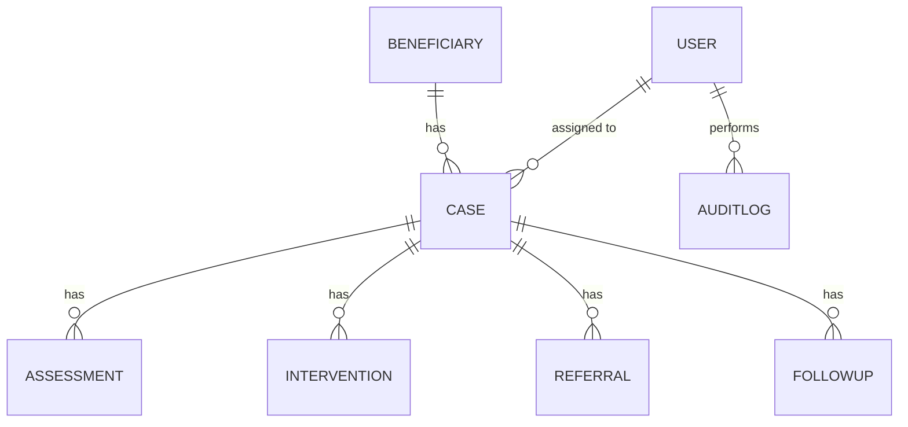

# Architecture

Layers: Browser → Flask blueprints (`app/routes`) → access layer (`app/security.py`) → SQLAlchemy models → SQLite/PostgreSQL.

Design rules
1. Every case-content route goes through `get_case_or_403`; every list/search/export through `accessible_cases_query`.
2. A referral is a request with a status; `verified_on` is set only when marked completed.
3. Closed cases reject new records; closure needs a reason and a supervisor.
4. Management/admin never receive case content.

## Roadmap (suggested sprints)
1. Core workflow (done in scaffold) - verify against Chapter One requirements.
2. Login lockout/rate limiting, password change, session timeout enforcement.
3. Reassignment history, supervisor team scopes, edit/correct records with audit.
4. Data retention/anonymisation job, PDF/CSV case summary.
5. Performance + usability evaluation (task timing, retrieval accuracy) for Chapter Three/Five.
6. Deploy: gunicorn + PostgreSQL + HTTPS (`COOKIE_SECURE=1`).
